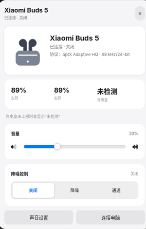

# Buds Panel

**A Linux control panel for Bluetooth earbuds — battery, ANC and codec switching.**

<p align="left">
  
</p>

[](LICENSE)
[](#requirements)
[](https://www.rust-lang.org/)
[](#architecture)
[](https://github.com/new-agent-lk/buds-panel/releases)

Buds Panel is a small Rust + GTK3 desktop app for Linux that talks directly to Bluetooth
earbuds over their control channel. It reads per-earbud and charging-case battery, switches
noise-cancelling modes, and selects the Bluetooth audio codec — all from a popover that hangs
off your top bar, backed by a resident D-Bus service you can also script.

> **Unofficial, community project, not affiliated with Xiaomi.**
>
> English | [简体中文](README.zh-CN.md)

---

## Demo

<p align="left"></p>

Click the top-bar tray icon to open the popover: per-earbud and case battery, live codec
indicator, volume, and one-tap noise-cancelling modes.

## Supported devices

| Device | Status |
| --- | --- |
| Xiaomi Buds 5 (R1) | Full support — battery, ANC, codec switching |
| Other Xiaomi / Redmi earbuds using the JieLi RCSP control protocol | Community-tested, not verified by the maintainer |

The control protocol (RCSP over Bluetooth Classic RFCOMM) is shared across many Xiaomi / Redmi
earbuds, so other models have a good chance of working. Only Xiaomi Buds 5 is actively developed
and tested. Adding a device generally means confirming its RFCOMM channel and battery attribute
layout — see [Technical notes](#technical-notes).

Xiaomi, Redmi and Buds are trademarks of their respective owners. This project is not affiliated
with or endorsed by Xiaomi.

## Features

- **Battery** — left, right and charging-case level (case shows "unknown" when it is not
  reported, which is normal when the case is away or the earbuds are out).
- **Noise control** — Off / Noise cancelling / Transparency, plus a three-step strength
  (Comfort / Balanced / Deep) on models that expose it.
- **Codec switching** — SBC, SBC-XQ, AAC, aptX Classic and the aptX Adaptive family
  (Adaptive / Adaptive HQ / Adaptive LL) when the optional high-quality audio stack is present.
- **Volume** — controls the A2DP sink that belongs to the earbuds.
- **Two front-ends** — a GTK3 status tray/popover (primary) and an optional GNOME 43
  Quick Settings extension.
- **Scriptable** — a `xiaomi-buds5` CLI and a stable D-Bus API for automation.
- **Multi-point friendly** — coexists with a phone that owns the audio stream instead of
  fighting it for the link.

## Requirements

- Linux with **BlueZ** and a desktop session (GTK3; tested on GNOME 43 / Wayland).
- **Rust toolchain** (`cargo`, `rustc`) — build-time only.
- **libgtk-3-dev** and **librsvg2-common** (the app renders its earbud icon from SVG).
- **PipeWire or PulseAudio** as the audio server.
- *Optional:* **libfdk-aac2** — needed only if you want AAC while the high-quality audio stack
  is active.

Install the build/runtime prerequisites on Debian/Ubuntu:

```sh
sudo apt install build-essential pkg-config libgtk-3-dev librsvg2-common libdbus-1-dev
# optional, for AAC in the high-quality stack:
sudo apt install libfdk-aac2        # or libfdk-aac-dev on some releases
```

## Install

```sh
git clone https://github.com/new-agent-lk/buds-panel.git
cd buds-panel
./install.sh
```

`install.sh` builds the Rust binaries (`cargo build --release`), installs the D-Bus service, the
GTK tray and the CLI, then enables the service and tray as user units. The app auto-discovers your
earbuds (override with `XIAOMI_BUDS5_MAC=AA:BB:CC:DD:EE:FF`); there is nothing to hard-code.

The GNOME extension is **not** installed by default (the tray is the primary UI). To install and
enable it as well, run `./install.sh --with-gnome-extension` and then **log out and back in once** —
GNOME only scans extension directories at login.

Uninstall with `./uninstall.sh`.

## Usage

### Tray / popover (primary UI)

The tray starts automatically at login (`xiaomi-buds5-tray.service`). Click the headphone icon in
the top bar to open the popover:

- battery for left / right / case,
- volume slider for the earbuds' A2DP sink,
- **Off / Noise cancelling / Transparency** and the strength selector,
- codec picker (under *audio settings*),
- a **Connect to computer** button to pull audio back from a phone that took it over.

### Command line

```sh
xiaomi-buds5 status              # battery, ANC mode, codec, backend, last error
xiaomi-buds5 noise anc           # anc | transparency | off
xiaomi-buds5 selftest            # health check: service reachable and earbuds connected
```

The CLI is a thin D-Bus client — it never opens the RFCOMM channel itself, so it is always safe
to run alongside the tray.

### GNOME extension (optional)

A GNOME 43 Quick Settings tile lives in `extension/`. It is **not installed or enabled by
default** — install it with `./install.sh --with-gnome-extension`, then log out and back in. Open
the top-right Quick Settings panel; the **Buds Panel** tile shows battery and lets you switch mode.
The extension is community-maintained and not verified against newer GNOME releases.

## Architecture

The project is four cooperating pieces; the tray does not touch Bluetooth or audio directly —
everything goes through the service over D-Bus.

```
  ┌─────────────┐   D-Bus (io.github.kang.XiaomiBuds5)   ┌──────────────────────────┐
  │  GTK tray   │ ────────────────────────────────────▶ │  service (Rust, zbus)    │
  │  (gtk-rs)   │ ◀──────────── StateChanged ─────────── │  • RFCOMM control channel│
  └─────────────┘                                        │  • battery / ANC / codec │
  ┌─────────────┐        same D-Bus API                  │  • audio backend switch  │
  │  CLI        │ ────────────────────────────────────▶ │                          │
  │ (xiaomi-buds5)│                                       └────────────┬─────────────┘
  └─────────────┘                                                     │ pactl / systemctl
  ┌──────────────────────┐                                            ▼
  │ GNOME extension (opt) │                          ┌──────────────────────────────┐
  └──────────────────────┘                          │ PipeWire / PulseAudio         │
                                                     │ + optional aptX-Adaptive stack│
                                                     └──────────────────────────────┘
```

| Component | Crate / dir | Role |
| --- | --- | --- |
| Service | `crates/xiaomi-buds5-service` | Resident D-Bus daemon. Owns the RFCOMM control channel, decodes battery/ANC, switches the audio backend and codec. |
| Tray | `crates/xiaomi-buds5-tray` | GTK3 status icon + popover, plus a hand-written StatusNotifierItem. The primary UI. |
| CLI | `crates/xiaomi-buds5-cli` | `xiaomi-buds5` — a thin D-Bus client for status, ANC and self-test. |
| Extension | `extension/xiaomi-buds5-panel@kang` | Optional GNOME 43 Quick Settings tile. |
| Audio stack (optional) | `audio-adaptive/` | Glue scripts to run an isolated PipeWire 1.7 + aptX Adaptive stack on demand. See below. |

The service exposes `io.github.kang.XiaomiBuds5` on the session bus with methods
(`Refresh`, `Connect`, `SetNoiseMode`, `SetNoiseLevel`, `SetAudioBackend`, `ListCodecs`) and
read-only properties (`Connected`, `Name`, `Address`, `Battery`, `NoiseMode`, `NoiseLevel`,
`AudioBackend`, `Codec`, `Codecs`, …), and emits `StateChanged` whenever anything changes.

## aptX Adaptive (optional, out-of-tree)

Standard PipeWire/PulseAudio can switch between SBC, AAC and aptX Classic. To expose the **aptX
Adaptive** family, Buds Panel can drive an isolated PipeWire 1.7 + WirePlumber stack with a
patched aptX Adaptive encoder.

That encoder is **not** shipped in this repository — it is a separate research implementation
([`AKS-Logic/aptx-adaptive-linux`](https://github.com/AKS-Logic/aptx-adaptive-linux)), kept
out-of-tree for licensing reasons (aptX is covered by Qualcomm patents; see that project's
`LEGAL.md`). The scripts in `audio-adaptive/` only orchestrate the switch.

If the stack is not present, Buds Panel simply does not offer the aptX Adaptive codecs and
falls back to the system audio server — nothing breaks. When it is available, the panel's
*audio settings* page lets you pick between:

- **Compatibility mode** — the system PulseAudio/PipeWire with SBC / AAC / aptX Classic, the safe default;
- **High-quality mode** — the isolated stack, adding aptX Adaptive / Adaptive HQ / Adaptive LL.

On Xiaomi Buds 5 the high-quality mode negotiates **aptX Adaptive HQ, 48 kHz / 24-bit, ~12 ms,
427 kbps**. "Adaptive HQ" is the high-quality tier of Qualcomm's Adaptive family — it is **not**
aptX Lossless, and this project does not claim Lossless.

See **[docs/aptx-adaptive.md](docs/aptx-adaptive.md)** for the full story: what the stack is, why
it is out of tree, how to build/obtain it, and how the panel degrades when it is absent.

## Technical notes

- **Transport:** Bluetooth Classic RFCOMM using the Xiaomi/JieLi RCSP frame format
  `FE DC BA | flags | opcode | len(u16 BE) | payload | EF`. The control channel is discovered
  automatically across the common RFCOMM channels.
- **Authentication:** Xiaomi/JieLi command auth — `AUTH_CHECK` (0x50) + `AUTH_SEND_CALC_RESULT`
  (0x51). The key-transform algorithm is ported from the MIT-licensed `redmi-buds-linux`
  project (see [Credits](#credits--license)).
- **Battery:** the multi-battery record of `GET_TARGET_INFO` (0x02); also handles the device's
  unsolicited `0x0e / type 4` battery frames. `0xFF` means "unknown", not a read error.
- **Noise control:** `SET_TARGET_INFO` (0x08) with `02 04 <mode>`, where
  `0=off, 1=ANC, 2=transparency`.
- **Codec switching** tells PipeWire/PulseAudio to set the card profile and then waits until the
  new sink actually exists with the requested codec before reporting success; on failure it rolls
  back to the previous profile.
- **Multi-point:** a phone and the computer cannot both play at once. The service keeps the BlueZ
  link up while the phone owns audio and only pulls audio back when you ask (the *Connect to
  computer* button / `Connect` method).

## Credits & License

- Licensed under **Apache-2.0** — see [LICENSE](LICENSE) and [NOTICE](NOTICE).
- The RCSP authentication key-transform in `crates/xiaomi-buds5-service/src/auth.rs` is ported
  from **`redmi-buds-linux`** by Deniz Tunç (MIT); see `LICENSE.redmi-buds-linux`.
- The optional aptX Adaptive encoder is the separate **`AKS-Logic/aptx-adaptive-linux`** project
  and is not part of this repository's license grant.

This is an independent, unofficial project. Xiaomi, Redmi and Buds are trademarks of their
respective owners; this project is not affiliated with or endorsed by Xiaomi.
