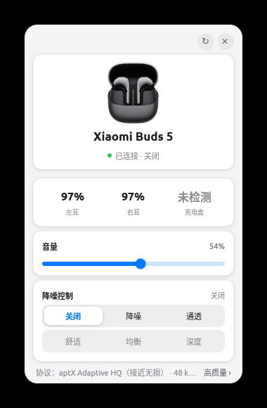
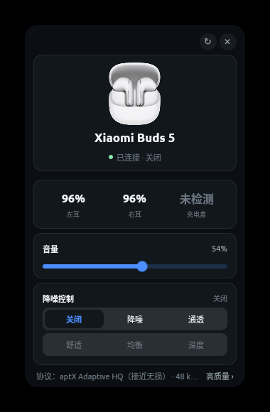
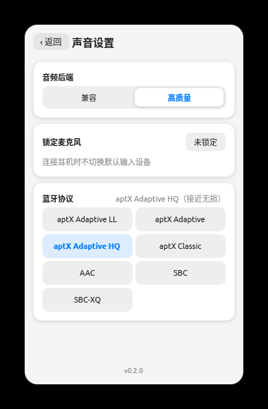
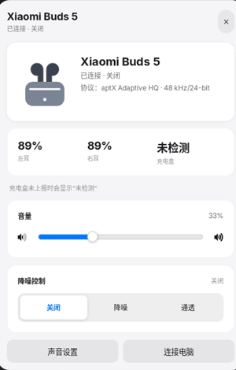

# Buds Panel

**一个 Linux 蓝牙耳机控制面板 —— 电量、降噪与编码切换。**

<p align="left">
  
  
  
</p>

[](LICENSE)
[](#依赖)
[](https://www.rust-lang.org/)
[-4a90d9.svg)](#架构)
[](https://github.com/new-agent-lk/buds-panel/releases)

Buds Panel 是一个用 Rust 写的 Linux 桌面小工具（当前为 GTK3 托盘，正在迁移到 GPUI），直接通过蓝牙耳机的控制通道读写状态。
它能读取左右耳与充电盒电量、切换降噪模式、选择蓝牙音频编码，全部集中在一个挂在顶栏下的弹窗里，
背后是一个常驻的 D-Bus 服务，也可以直接在脚本里调用。

> **非官方社区项目，与小米无关。**
>
> [English](README.md) | 简体中文

---

## 演示

<p align="left"></p>

点击顶栏托盘图标打开弹窗：左右耳与充电盒电量、实时编码指示、音量、一键降噪模式。

## 支持的设备

| 设备 | 状态 |
| --- | --- |
| Xiaomi Buds 5 (R1) | 完整支持 —— 电量、降噪、编码切换 |
| 其它使用 JieLi RCSP 控制协议的 Xiaomi / Redmi 耳机 | 社区测试过，维护者未逐一验证 |

控制协议（Bluetooth Classic RFCOMM 上的 RCSP）被许多小米 / 红米耳机共用，所以其它型号也有较大
机会能用；但当前只在 Xiaomi Buds 5 上开发与验证。新增机型通常只需确认它的 RFCOMM 通道和电量属性
布局 —— 见 [技术说明](#技术说明)。

Xiaomi、Redmi、Buds 是各自权利人的商标；本项目与小米无隶属关系，也未获其背书。

## 功能

- **电量** —— 左耳、右耳、充电盒（充电盒未上报时显示"未检测"，充电盒不在附近或耳机取出时属正常）。
- **降噪控制** —— 关闭 / 降噪 / 通透，以及在支持的机型上提供三档强度（舒适 / 均衡 / 深度）。
- **编码切换** —— SBC、SBC-XQ、AAC、aptX Classic，以及（在可选高质量音频栈可用时）aptX Adaptive 系列
  （Adaptive / Adaptive HQ / Adaptive LL）。
- **音量** —— 控制耳机对应的 A2DP sink。
- **前端** —— GPUI 面板（新默认，迁移中）、GTK3 状态托盘/弹窗（回退，`--ui=gtk`）与可选的 GNOME 43 快捷设置扩展。
- **可脚本化** —— 提供 `xiaomi-buds5` 命令行工具和稳定的 D-Bus 接口。
- **多点友好** —— 手机占用音频流时与它共存，而不是去抢链路。

## 依赖

- Linux，带 **BlueZ** 与桌面会话。GPUI 面板需要 GPU（**Vulkan 1.x 或 OpenGL**，可用 lavapipe 软渲兜底）
  与 **XWayland**（弹窗会强制 X11 后端以贴图标定位）。已在 GNOME 43 / Wayland 上测试。
- **Rust 工具链**（`cargo`、`rustc`）—— 仅构建时需要。
- **libgtk-3-dev** 与 **librsvg2-common** —— 仅在构建 GTK 托盘回退时需要。
- GPUI 构建依赖：**libxkbcommon-x11-dev**、`libxkbcommon-dev`、`libwayland-dev`、`libx11-xcb-dev`、`libvulkan-dev`。
- **PipeWire 或 PulseAudio** 作为音频服务器。
- *可选：* **libfdk-aac2** —— 只有想在高质量音频栈里使用 AAC 时才需要。

在 Debian/Ubuntu 上安装构建/运行依赖：

```sh
sudo apt install build-essential pkg-config libdbus-1-dev libgtk-3-dev librsvg2-common \
  libxkbcommon-x11-dev libxkbcommon-dev libwayland-dev libx11-xcb-dev libvulkan-dev
# 可选，高质量栈里用 AAC：
sudo apt install libfdk-aac2        # 部分发行版为 libfdk-aac-dev
```

## 安装

```sh
git clone https://github.com/new-agent-lk/buds-panel.git
cd buds-panel
./install.sh
```

`install.sh` 会构建 Rust 程序（`cargo build --release`）、安装 D-Bus 服务、GPUI 面板（默认）与命令行工具，
并把它们启用为开机自启的用户单元。加 `--ui=gtk`（或 `XIAOMI_BUDS5_UI=gtk`）改用旧的 GTK 托盘 ——
旧托盘始终保留，一条命令即可回滚（`./install.sh --ui=gtk`）。程序会自动发现你的耳机
（可用 `XIAOMI_BUDS5_MAC=AA:BB:CC:DD:EE:FF` 覆盖），无需写死任何信息。

GNOME 扩展**默认不安装**（托盘为回退界面）。若要一并安装并启用，运行
`./install.sh --with-gnome-extension`，然后**注销并重新登录一次** —— GNOME 只在登录时扫描扩展目录。

卸载：`./uninstall.sh`。

## 使用

### GPUI 面板（默认）/ GTK 托盘（回退）

面板随登录自动启动（`xiaomi-buds5-panel-gpui.service`）；用 `--ui=gtk` 时改为 GTK 托盘
（`xiaomi-buds5-tray.service`）。点击顶栏的耳机图标打开弹窗：

- 左 / 右 / 盒电量，
- 耳机 A2DP sink 的音量滑杆，
- **关闭 / 降噪 / 通透** 与强度选择，
- 编码选择（在"声音设置"里），
- **重新连接** 按钮（GTK 托盘里叫 *连接电脑*），把被手机接管的音频拉回电脑。

### 命令行

```sh
xiaomi-buds5 status              # 电量、降噪模式、编码、后端、最近错误
xiaomi-buds5 noise anc           # anc | transparency | off
xiaomi-buds5 selftest            # 自检：服务可达且耳机已连接
```

命令行是薄 D-Bus 客户端 —— 它自己不占用 RFCOMM 通道，所以随时可以和托盘一起运行。

### GNOME 扩展（可选）

`extension/` 下有一个 GNOME 43 快捷设置磁贴，**默认不安装、不启用** —— 用
`./install.sh --with-gnome-extension` 安装后注销重登。登录后打开右上角快捷设置面板，
**Buds Panel** 磁贴会显示电量并可切换模式。该扩展由社区维护，未在更新的 GNOME 版本上验证。

## 架构

项目由五个协同部分组成；前端不直接碰蓝牙或音频 —— 一切都通过 D-Bus 交给服务处理。

```
  ┌─────────────┐   D-Bus (io.github.kang.XiaomiBuds5)   ┌──────────────────────────┐
  │  GTK 托盘   │ ────────────────────────────────────▶ │  服务 (Rust, zbus)       │
  │  (gtk-rs)   │ ◀──────────── StateChanged ─────────── │  • RFCOMM 控制通道       │
  └─────────────┘                                        │  • 电量 / 降噪 / 编码    │
  ┌─────────────┐        同一套 D-Bus 接口               │  • 音频后端切换          │
  │  命令行      │ ────────────────────────────────────▶ │                          │
  │ (xiaomi-buds5)│                                       └────────────┬─────────────┘
  └─────────────┘                                                     │ pactl / systemctl
  ┌──────────────────────┐                                            ▼
  │ GNOME 扩展（可选）    │                          ┌──────────────────────────────┐
  └──────────────────────┘                          │ PipeWire / PulseAudio         │
                                                     │ + 可选 aptX-Adaptive 音频栈   │
                                                     └──────────────────────────────┘
```

| 组件 | crate / 目录 | 职责 |
| --- | --- | --- |
| 服务 | `crates/xiaomi-buds5-service` | 常驻 D-Bus 守护进程。持有 RFCOMM 控制通道、解析电量/降噪、切换音频后端与编码。 |
| 托盘 | `crates/xiaomi-buds5-tray` | GTK3 状态图标 + 弹窗，外加手写的 StatusNotifierItem。GPUI 迁移期间的回退界面。 |
| GPUI 面板 | `crates/xiaomi-buds5-panel-gpui` | GPUI（基于 Zed）弹窗前端，新默认界面；迁移完成后取代 GTK 托盘。 |
| 命令行 | `crates/xiaomi-buds5-cli` | `xiaomi-buds5` —— 薄 D-Bus 客户端，用于状态、降噪、自检。 |
| 扩展 | `extension/xiaomi-buds5-panel@kang` | 可选的 GNOME 43 快捷设置磁贴。 |
| 音频栈（可选） | `audio-adaptive/` | 按需启动隔离的 PipeWire 1.7 + aptX Adaptive 栈的脚本。见下。 |

服务在会话总线上提供 `io.github.kang.XiaomiBuds5`，含方法（`Refresh`、`Connect`、
`SetNoiseMode`、`SetNoiseLevel`、`SetAudioBackend`、`ListCodecs`）与只读属性（`Connected`、
`Name`、`Address`、`Battery`、`NoiseMode`、`NoiseLevel`、`AudioBackend`、`Codec`、`Codecs` 等），
状态变化时发出 `StateChanged` 信号。

## aptX Adaptive（可选，仓库外）

标准 PipeWire/PulseAudio 能在 SBC、AAC、aptX Classic 之间切换。要暴露 **aptX Adaptive** 系列，
Buds Panel 可以驱动一套隔离的 PipeWire 1.7 + WirePlumber，并加载打过补丁的 aptX Adaptive 编码器。

该编码器**不随本仓库分发** —— 它是独立的实验实现
（[`AKS-Logic/aptx-adaptive-linux`](https://github.com/AKS-Logic/aptx-adaptive-linux)），出于授权原因
（aptX 受高通专利约束，见该项目的 `LEGAL.md`）放在仓库之外。`audio-adaptive/` 里的脚本只负责编排切换。

若音频栈不存在，Buds Panel 就不提供 aptX Adaptive 编码，自动回退到系统音频服务器 —— 不会出错。
可用时，面板的"声音设置"页可在两种模式间选择：

- **兼容模式** —— 系统 PulseAudio/PipeWire，SBC / AAC / aptX Classic，稳妥的默认；
- **高质量模式** —— 隔离音频栈，额外提供 aptX Adaptive / Adaptive HQ / Adaptive LL。

在 Xiaomi Buds 5 上，高质量模式协商为 **aptX Adaptive HQ，48 kHz / 24-bit，约 12 ms，427 kbps**。
"Adaptive HQ" 是高通 Adaptive 系列的高质量档，**并非** aptX Lossless，本项目不宣称 Lossless。

完整说明见 **[docs/aptx-adaptive.md](docs/aptx-adaptive.md)**：这套栈是什么、为何外置、如何构建/获取，
以及缺失时面板如何降级。

## 技术说明

- **传输**：Bluetooth Classic RFCOMM，使用小米/JieLi 的 RCSP 帧格式
  `FE DC BA | flags | opcode | len(u16 BE) | payload | EF`。控制通道会在常见 RFCOMM 通道间自动发现。
- **认证**：小米/JieLi 命令认证 —— `AUTH_CHECK` (0x50) + `AUTH_SEND_CALC_RESULT` (0x51)。密钥变换算法
  移植自 MIT 许可的 `redmi-buds-linux` 项目（见 [致谢](#致谢与许可)）。
- **电量**：`GET_TARGET_INFO` (0x02) 的多电池记录；同时兼容设备主动上报的 `0x0e / type 4` 电量帧。
  `0xFF` 表示"未知"，不是读取失败。
- **降噪**：`SET_TARGET_INFO` (0x08) 的 `02 04 <mode>`，`0=关闭, 1=降噪, 2=通透`。
- **编码切换**：会让 PipeWire/PulseAudio 设置 card profile，然后等新 sink 真正出现且编码正确才报告成功；
  失败则回滚到上一个 profile。
- **多点**：手机与电脑不能同时出声。手机占用音频时服务保持 BlueZ 链路，只有你主动点击
  （*连接电脑* 按钮 / `Connect` 方法）才把音频拉回电脑。

## 致谢与许可

- 以 **Apache-2.0** 许可发布 —— 见 [LICENSE](LICENSE) 与 [NOTICE](NOTICE)。
- `crates/xiaomi-buds5-service/src/auth.rs` 中的 RCSP 认证密钥变换移植自 Deniz Tunç 的
  **`redmi-buds-linux`**（MIT）；见 `LICENSE.redmi-buds-linux`。
- 可选的 aptX Adaptive 编码器属于独立的 **`AKS-Logic/aptx-adaptive-linux`** 项目，不在本仓库的许可授权内。

本项目为独立、非官方项目。Xiaomi、Redmi、Buds 是各自权利人的商标；本项目与小米无隶属关系，也未获其背书。
